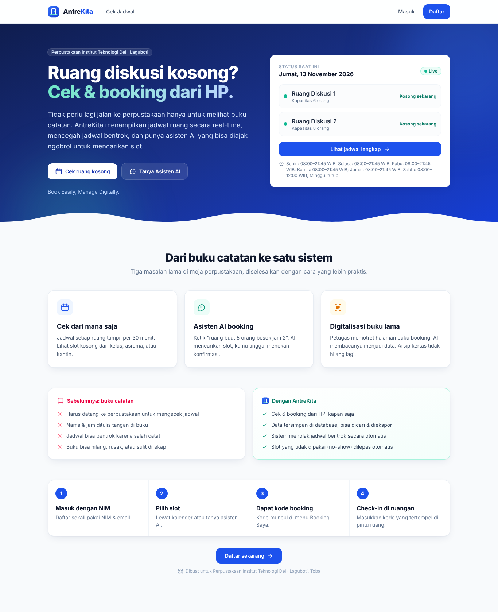
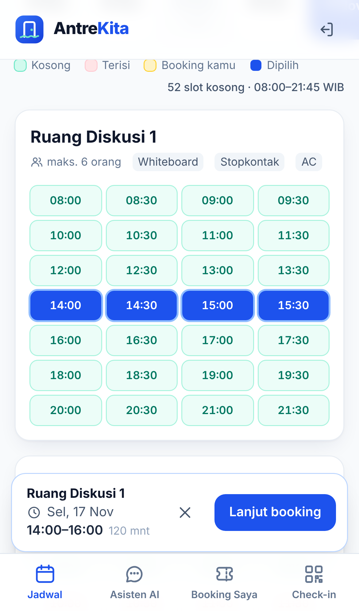
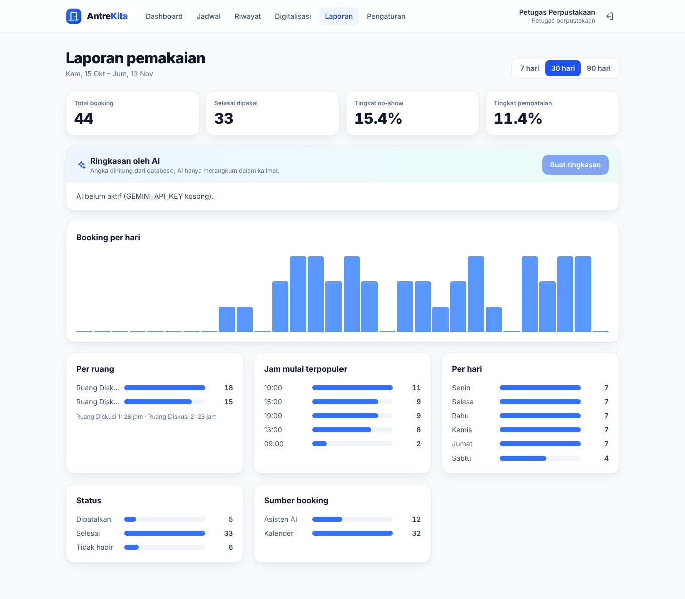

# AntreKita — Book Easily, Manage Digitally

Sistem reservasi ruang diskusi **Perpustakaan Institut Teknologi Del** berbasis web, dengan asisten AI (Google Gemini).

Mahasiswa bisa mengecek ketersediaan ruang dan booking dari HP tanpa harus datang ke perpustakaan. Petugas tidak perlu lagi mencatat booking di buku: semua data tersimpan di database, bisa dicari, diekspor, dan dilaporkan.

## Fitur

**Mahasiswa**
- Jadwal real-time per ruang (slot 30 menit), bisa dilihat tanpa login
- Booking dari kalender: ketuk jam mulai, ketuk jam selesai, isi keperluan, dapat kode booking
- **Asisten AI**: booking dengan bahasa sehari-hari, misalnya *"ruang buat 5 orang besok jam 2"*. AI mencari slot lewat function calling, lalu menampilkan kartu konfirmasi. Booking baru tersimpan setelah mahasiswa menekan **Konfirmasi**.
- Booking Saya: daftar booking aktif, pembatalan, dan riwayat
- Check-in di ruangan dengan kode/QR yang tertempel di pintu (`/checkin/RD1-TOBA`)

**Petugas**
- Dashboard hari ini: check-in, tandai selesai, batalkan
- Booking walk-in atas nama tamu/mahasiswa
- Riwayat dengan pencarian (nama, NIM, kode, keperluan) dan filter, plus **Ekspor CSV** untuk arsip/cadangan
- **Digitalisasi buku booking (AI vision)**: foto halaman buku, AI membaca tulisan tangan menjadi tabel, petugas mereview, lalu menyimpan
- **Laporan pemakaian + ringkasan AI**: angka dihitung dengan SQL, AI hanya menulis narasinya
- Pengaturan: ruangan, kapasitas, fasilitas, kode check-in, jam layanan, dan aturan booking

**Aturan yang dijaga sistem** (bisa diubah petugas)

| Aturan | Default |
|---|---|
| Jam layanan | Sen–Jum 08:00–21:45, Sab 08:00–12:00, Minggu tutup (sesuai website IT Del) |
| Durasi maksimal | 120 menit, slot 30 menit |
| Minimal peserta | 2 orang, maksimal = kapasitas ruang |
| Booking ke depan | maksimal 7 hari |
| Booking aktif per mahasiswa | maksimal 2 |
| Check-in | dibuka 10 menit sebelum mulai. Kalau belum check-in 15 menit setelah mulai, status otomatis menjadi **no-show** dan slot dilepas |
| **Anti double booking** | dijaga di aplikasi **dan** di database (PostgreSQL `EXCLUDE` constraint), jadi tetap aman walaupun dua orang menekan Booking di detik yang sama |

## Teknologi

| Bagian | Pilihan | Biaya |
|---|---|---|
| Framework | Next.js 15 (App Router) + React 19 + TypeScript | — |
| Tampilan | Tailwind CSS 4, mobile-first | — |
| Database | PostgreSQL ([Neon](https://neon.tech)) + Drizzle ORM | Gratis |
| AI | Google Gemini (`@google/genai`), function calling + vision | Free tier |
| Login | Email/NIM + kata sandi (bcrypt), sesi JWT di cookie httpOnly | — |
| Hosting | [Vercel](https://vercel.com) | Gratis (Hobby) |

## Struktur folder

```
antrekita/
├── db/migrations/0001_init.sql   # Struktur tabel + constraint anti bentrok
├── scripts/
│   ├── migrate.ts                # Menjalankan migrasi SQL
│   └── seed.ts                   # Data awal: aturan, jam, ruang, akun demo, contoh booking
├── src/
│   ├── db/                       # Skema Drizzle & koneksi
│   ├── lib/
│   │   ├── booking.ts            # Inti logika: validasi, anti bentrok, no-show, ketersediaan
│   │   ├── ai.ts                 # Gemini: asisten chat, baca buku, ringkasan laporan
│   │   ├── rules.ts  stats.ts  queries.ts  time.ts (zona WIB)  auth.ts
│   ├── middleware.ts             # Proteksi halaman (login & role petugas)
│   ├── components/               # Nav, Logo, ikon, kartu booking
│   └── app/
│       ├── page.tsx              # Beranda + status ruang live
│       ├── jadwal/               # Kalender & booking
│       ├── asisten/              # Chat AI
│       ├── saya/  checkin/  login/  daftar/
│       ├── petugas/              # dashboard, riwayat, digitalisasi, laporan, pengaturan
│       └── api/                  # REST API
├── .env.example
└── vercel.json                   # Region Singapura (dekat Indonesia)
```

## Deploy gratis (Vercel + Neon + Gemini), sekitar 15 menit, tanpa perlu laptop

### 1. Upload kode ke GitHub
Buat repo baru di GitHub, lalu upload semua isi folder ini. File `.env` tidak ikut ter-upload, jadi aman walaupun repo-nya publik. Lomba Devpost memang mewajibkan repo publik.

### 2. Buat database di Neon
1. Daftar di https://neon.tech, lalu klik **New Project** dan pilih region **AWS Asia Pacific (Singapore)**.
2. Di dashboard, klik **Connect** dan salin connection string yang **Pooled**. Isinya kira-kira `postgresql://...-pooler...neon.tech/neondb?sslmode=require`.

### 3. Ambil API key Gemini
Buka https://aistudio.google.com/apikey, klik **Create API key**, lalu salin key-nya.

### 4. Deploy di Vercel
1. Buka https://vercel.com/new, login dengan GitHub, lalu **Import** repo AntreKita.
2. Buka **Environment Variables** dan isi:

| Nama | Isi |
|---|---|
| `DATABASE_URL` | connection string pooled dari Neon |
| `AUTH_SECRET` | string acak minimal 32 karakter (ketik bebas, panjang) |
| `GEMINI_API_KEY` | key dari AI Studio |
| `GEMINI_MODEL` | `gemini-2.5-flash` |
| `SEED_STAFF_EMAIL` | email login petugas, mis. `petugas@antrekita.id` |
| `SEED_STAFF_PASSWORD` | **password petugas, ganti dari default!** |
| `SEED_DEMO_DATA` | `true` untuk demo lomba (akun mahasiswa demo + contoh riwayat), `false` untuk dipakai sungguhan |
| `ALLOWED_EMAIL_DOMAINS` | opsional, mis. `students.del.ac.id,del.ac.id` |

3. Klik **Deploy**. Saat build, tabel database dibuat dan data awal diisi otomatis (`vercel-build` menjalankan `migrate` lalu `seed`, dan keduanya aman diulang).
4. Selesai. Buka link `https://<nama-proyek>.vercel.app`.

### 5. Setelah online
- Login petugas memakai email/password yang kamu isi di langkah 4. Akun mahasiswa demo: NIM `11S22001` / `mahasiswa123`.
- Buka **Petugas → Pengaturan** untuk menyesuaikan nama, jumlah, dan kapasitas ruang dengan kondisi asli. Website IT Del menyebut perpustakaan punya 2 unit ruang diskusi, tetapi kapasitas dan fasilitas di seed masih contoh.
- Buat QR code dari link check-in tiap ruang (terlihat di Pengaturan) dengan generator QR apa saja, lalu tempel di pintu.
- Kalau kamu mengubah environment variable, lakukan **Redeploy** di Vercel supaya perubahannya berlaku.

## Menjalankan di laptop
```bash
npm install
cp .env.example .env     # isi DATABASE_URL (Neon, atau Postgres lokal), AUTH_SECRET, GEMINI_API_KEY
npm run db:setup         # buat tabel + data awal
npm run dev              # http://localhost:3000
```

## Desain AI yang aman
- **AI tidak pernah menulis ke database secara langsung.** Asisten hanya bisa memanggil fungsi baca (`check_availability`, `get_my_bookings`) dan `propose_booking`, yang memvalidasi tanpa menyimpan. Penyimpanan selalu lewat tombol Konfirmasi dan API yang sama dengan form biasa, sehingga semua aturan tetap berlaku.
- **Digitalisasi buku butuh review manusia.** Kolom yang kurang yakin ditandai kuning. Foto tidak disimpan di server.
- **Laporan tidak mengarang angka.** Statistik dihitung SQL, AI hanya merangkum JSON hasilnya.
- **Ada fallback tanpa AI.** Kalau kuota/kunci Gemini bermasalah, kalender, form, dan input manual tetap berjalan.

## Keterbatasan
- Pembacaan tulisan tangan bisa keliru pada tulisan yang berantakan, jadi selalu ada review petugas.
- Login masih akun lokal AntreKita, belum terhubung SSO/CIS kampus.
- Belum ada notifikasi email/WhatsApp pengingat booking.
- Data ruang & aturan di seed adalah contoh, belum diverifikasi dengan pihak perpustakaan.

## Backup data
- Neon menyimpan riwayat perubahan (point-in-time restore) secara otomatis. Lihat menu *Branches/Restore* di dashboard Neon.
- Petugas bisa mengekspor semua booking ke CSV kapan saja dari **Riwayat → Ekspor CSV**.

## Tangkapan layar

| Beranda | Jadwal (HP) | Laporan petugas |
|---|---|---|
|  |  |  |
